<div align="center">

# 🏓 UnumPingPong

**AI agents play ping-pong with your tasks. A referee decides who scores.**

[](https://github.com/corpunum/unumpingpong/actions/workflows/ci.yml) [](https://github.com/corpunum/unumpingpong/releases) [](LICENSE) 



</div>

## The idea in 30 seconds

You give an AI agent a task. It says *"done!"*. Is it?

UnumPingPong never takes the agent's word for it. Every task is a **ball** served to a **player**
(Claude Code, Codex, opencode, a local model, any command). When the player hits an answer back,
an independent **referee** checks it with the real thing: your tests, a file, an endpoint.
**Fail?** The ball goes straight back, with the exact error, to the same player. **Pass?**
The table scores a **point**. Only verified work scores.

Run one table, or a whole hall of them:



## Does it work? Real repo, real bugs

We took **10 real bug fixes** from our own agent framework (OpenUnum, a private repo; the harness
works on any repository), rewound each to just before the fix, and handed every agent the same
issue title plus the failing test, but **not** the file to change. A task counts only if its real unit test passes
afterwards and the test was not touched.



What we learned (mostly one run per cell: a first signal, not a law):

- **Open models gain the most from a referee.** On free NVIDIA NIM, `nemotron-3-ultra` went from
  **1/10 alone to 10/10 at tables** and `gpt-oss-20b` from **0/10 to 7/10**; local **Qwen 3.6 35B**
  went from 7/10 to **9/10**. The exact test failure, handed back to the same player, is what
  turns "almost" into "done". (The same nemotron via opencode's free tier was the exception:
  10/10 alone, 7/10 at tables.)
- **Claude Haiku** (Claude Code): same 10/10 either way, but tables were **~8x faster and half the
  cost**. One long Claude Code session drags every earlier task along; small tables stay focused.
- **GPT Luna** (Codex CLI): tables reached **10/10 in every run**, the single session stopped early
  (7/10, 6/10, 10/10), but tables cost 3-5x the tokens. Codex caches a long session cheaply, so
  that session wins on cost and loses on reliability. A short player prompt cut the tables' cost
  by **34%** at the same 10/10; sharing one session across tables did *not* help (it cost the most).
  Luna inside the OpenUnum agent loop also went 10/10, fastest of all (105 s).
- **Small local models** can call tools but not fix real bugs: SuperGemma 4 on a ROG Ally 1/10,
  Gemma-4 E2B on a Galaxy S22 0/3.

So the recommended setup depends on the player: parallel tables for Claude Code, open and
local models; tables with a lean `system_prompt` for Codex when reliability matters. Full table:
[bench/repo/results.md](bench/repo/results.md).

The harness is in [bench/repo](bench/repo) (`python3 bench/repo/repo_bench.py --player …`);
older synthetic task sets are in [docs/BENCHMARKS.md](docs/BENCHMARKS.md).

## Why a referee changes everything

| Without a referee | With UnumPingPong |
|---|---|
| "Done!" means the agent *thinks* it is done | done means **your tests pass** |
| failures hide in a long transcript | a failure comes back as a precise ball: *this test, this error* |
| one agent, one task at a time | many **tables** in parallel, or **chains** (plan → build → test) |
| you read thousands of lines | you read one **card** per table: done, evidence, open issues |
| a crash loses the session | every rally is in SQLite: replay, resume, audit, train on it |

## Try it in one minute

```bash
curl -fsSL https://github.com/corpunum/unumpingpong/releases/latest/download/install.sh | sh
upp --db /tmp/upp-demo.db run examples/demo/demo.toml --watch   # no model needed: scripted players, real referee
```

A real table is a few lines of TOML:

```toml
[[table]]
name    = "fix-tests"
ball    = "The tests fail. Fix the code, not the tests."
player  = { kind = "claude" }                       # or codex, gemini, opencode, openunum, openai, shell
referee = [{ kind = "command", run = "cargo test" }]
lease   = { max_rallies = 5, wall_secs = 900 }      # a guard against runaways, nothing more
```

```bash
upp run fix-tests.toml --watch     # live TUI of every table
upp list                           # who scored, who lost, why
```

<details>
<summary><b>🏓 For engineers: the pings, in one table</b></summary>

| Term | What it is |
|---|---|
| **ball** | the brief a player receives (task, files, the referee's checks) |
| **rally** | player answers → referee checks → the ball is returned with the evidence, or scores |
| **ping** | every event of a rally: SQLite trace, SSE stream (`uppd`), MCP (`upp mcp`) |
| **point** | the referee passed: a verified result, tied to the exact git tree it checked |
| **card** | the compact result of a rally: `done`, `evidence`, `open_issues`, `artifacts`, tokens |
| **server** | who serves and reviews: the referee alone, a model, you, or a long-lived orchestrator over MCP |
| **lease** | wall time, rallies, tokens, cost: a runaway guard, never the scheduler |
| **share** | tables that take turns in one player session (an option; it did not pay off for Codex in our runs) |
| **worktree** | each coding table gets its own git worktree; children that write get their own too |

The engine is one Rust library with thin front-ends: CLI with a TUI (`upp`), daemon with an
HTTP/JSON API and Server-Sent Events (`uppd`, token-protected beyond localhost), MCP server
(`upp mcp`), and an Agent Skill. It has no GPU, model or vendor dependency of its own.

</details>

<details>
<summary><b>🧩 Plug in any agent</b></summary>

| Player | How it plays | Status |
|---|---|---|
| `claude` | Claude Code, one persistent stream-json process per table | run live |
| `codex` | Codex `app-server`, one thread per table | run live |
| `opencode` | `opencode run`, any provider/model (free tier, NVIDIA NIM, local) | run live |
| `openunum` | an OpenUnum agent session per table (our own framework) | run live |
| `gemini` | Gemini CLI | flags verified |
| `openai` | any OpenAI-compatible endpoint (llama.cpp, vLLM, Ollama, LM Studio, Halogen) | run live |
| `shell` | any command | tested |

Recipes per tool: [docs/integrations](docs/integrations/README.md).

</details>

<details>
<summary><b>🔒 Safety rails</b></summary>

- The referee is deterministic first (commands, files, HTTP, JSON); a model judge is never the player itself.
- `review = "required"`: with a mandatory reviewer, no point without a real review.
- Crash recovery never replays a half-finished rally blind; the wall lease survives restarts.
- `uppd` requires a bearer token on any non-loopback address; `UPP_GLOBAL_PARALLEL` caps all runs on one machine.

</details>

## Learn more

[Reference](docs/REFERENCE.md) (every option) · [Integrations](docs/integrations/README.md) ·
[Benchmarks](bench/repo/results.md) · [Changelog](CHANGELOG.md) · [Agent Skill](skills/unumpingpong/SKILL.md)

<sub>Apache-2.0 · built by [corpunum](https://github.com/corpunum) · sibling project:
[UnumSearch](https://github.com/corpunum/unumsearch) (fast local code search, pluggable into players)</sub>
