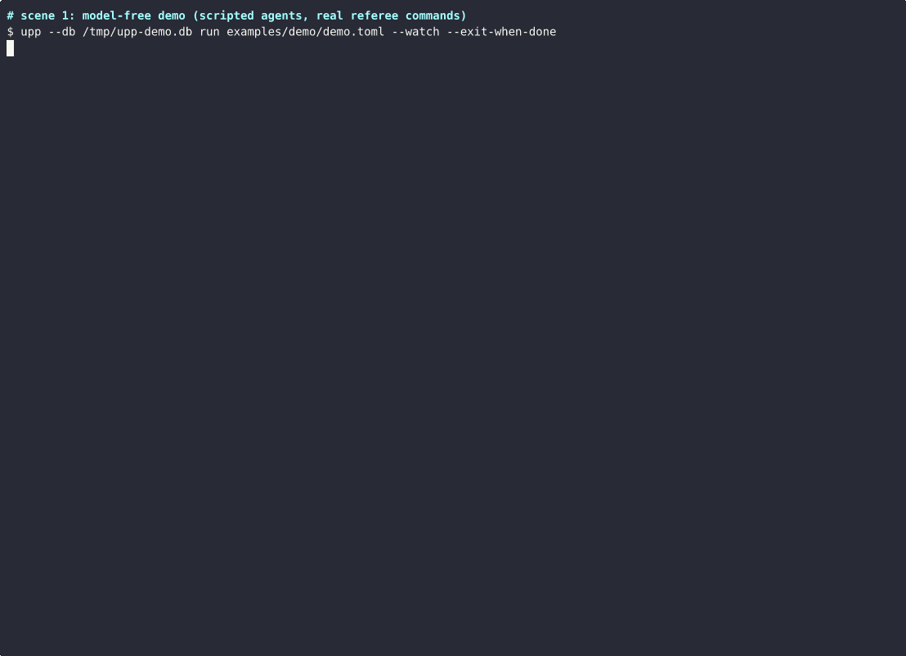
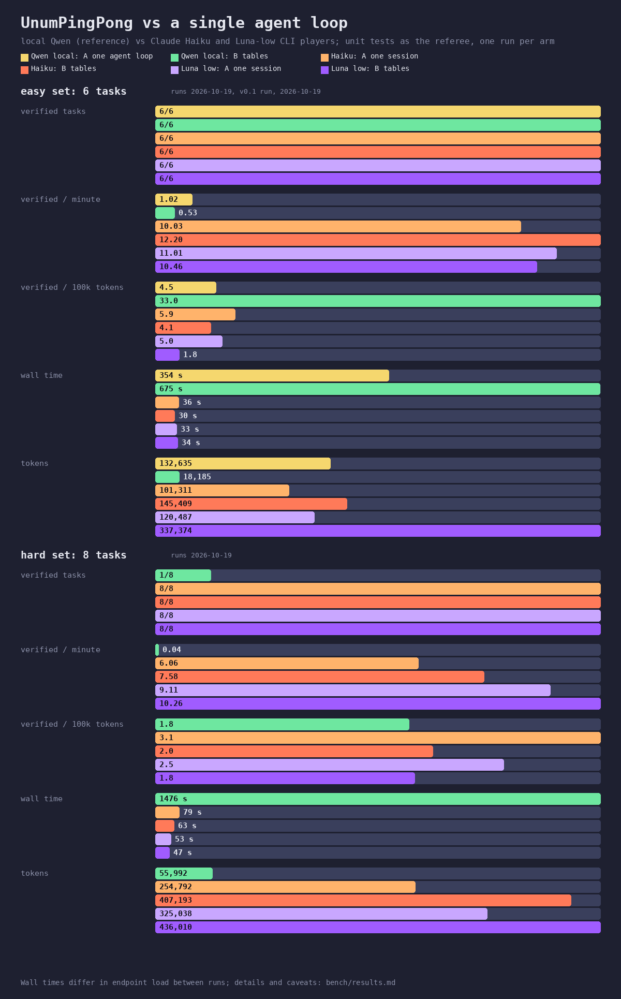
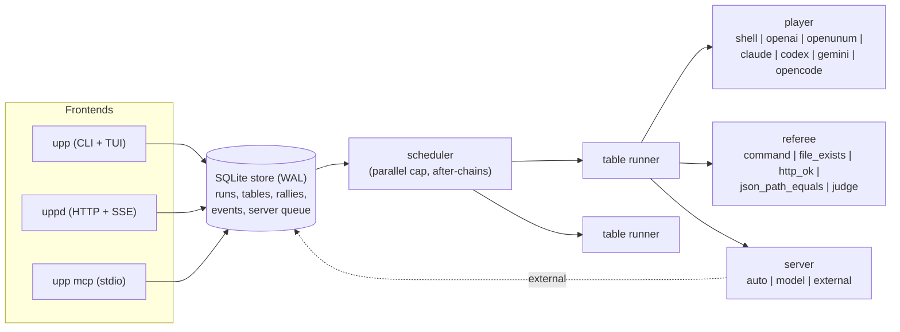

# UnumPingPong

Orchestrator <-> worker ping-pong for coding agents, with an external referee. Written in Rust.

You plug any coding or agent tool in as a **player** (Claude Code, Codex, Gemini CLI, opencode,
OpenUnum, any OpenAI-compatible model, or any command), give it a **ball** (a brief), and an
external **referee** checks every answer with deterministic evidence: a test command, a file, an
HTTP endpoint, a JSON value. If the check fails, the ball goes back to the same player session
with the referee output and a server note. If it passes, the table scores a **point**. Many
**tables** run in parallel under a cap, and tables chain in series (a point becomes the next
table's ball). Every rally is appended to a SQLite store: a replayable trace, and training data.

One engine with thin front-ends: a **library** (`upp-core`), a **CLI** with a live TUI (`upp`),
a **daemon** with a local HTTP/JSON API and Server-Sent Events (`uppd`), an **MCP server**
(`upp mcp`), and an **Agent Skill**. No GPU, model or network dependency of its own; nothing in
it is specific to one agent, model vendor or operating system.



*Real terminal recording (asciinema), nothing animated. Scene 1 is the model-free demo (scripted
agents, real referee commands): a cap of 4 leaves one table queued, returned balls carry the
referee output, one table is lost after its rallies, and `plan -> build -> ship` unlocks in
series. Scene 2 is a real run of `examples/three-functions.toml` against a local model, shown at
3x speed (88 s real time). On a 6-task benchmark both a single agent loop and UnumPingPong solved
6/6 with unit-test referees; the tables used 4.6x fewer tokens (28.8k vs 132.6k) but took 1.6x
the wall time (580 s vs 354 s). See [Benchmark](#benchmark).*

<details>
<summary>Benchmark result card</summary>



</details>

## Why

The observation behind it: development goes fastest when **one orchestrator works with many
workers, reviews each answer as soon as it arrives, and returns the ball at once**, with a
precise correction, the next task, or a verified "done". UnumPingPong makes that loop a
mechanism instead of a habit:

- **Small, fresh contexts.** Each table is one ball for one player session. A worker does not
  carry the history of every other task; a return message carries only what failed (the
  referee output, trimmed) and the server's note. Players that keep a session (Claude Code
  `--resume`, Codex `exec resume`, a kept OpenAI-compatible conversation, a Halogen
  keep/fork handle) reuse their prompt cache across rallies.
- **Verification outside the player.** The player never grades itself. Deterministic checks
  run first (exit codes, tests, files, HTTP status, JSON values); an LLM judge is a last
  resort, runs only after every deterministic check passed, and must be a different player.
  That stops "claimed done" and most reward hacking: a point needs evidence.
- **The server sees results, not transcripts.** The orchestrator (a template, a model, or you /
  Claude / Codex over MCP) reads the ball, the answer and the referee verdict, and writes one
  note. That is cheap enough to drive many tables at once.
- **Every rally is recorded.** Ball, answer, referee checks, server note, tokens, cost, timing,
  session id: one append-only row per rally. `upp export` turns it into JSON lines for
  analysis or for training briefing models, routers and judges.

## Benchmark

[`bench/`](bench/) solves the same six small Python tasks twice with the same local model:
(A) one agent loop, a single conversation where the model self-checks and says DONE, and (B)
UnumPingPong tables (fresh small context per ball, referee feedback, 3 in parallel). Both are
scored afterwards by the same unit tests. Result (one run, honest): both 6/6; B used 4.6x fewer
tokens, A's "done" was never wrong on this easy set, and B was slower in wall time. Details,
caveats and the reproduce command are in [bench/results.md](bench/results.md).

## Concepts

| Term | Meaning |
| --- | --- |
| **Table** | A loop with a goal: one player, one referee, one server, and a lease. |
| **Ball** | The unit of work: a brief (with templates for files and the upstream answer) plus the evidence expected. |
| **Rally** | Player answers -> referee checks -> server reviews -> the ball goes back with the referee output and a note, or the point is scored. |
| **Point** | The ball accepted with evidence. The answer is stored as the table's result and becomes `{{prev.answer}}` downstream. |
| **Lease** | Wall time, max rallies, optional token and cost budget. The first one reached ends the table. |
| **Parallel** | Tables run at once up to `max_parallel` (per scheduler process). |
| **Serial** | `after = "other-table"`: start only after that table scored. If it ends without a point, the chain is skipped. |
| **Server** | `auto` (template feedback), `model` (another player writes the note), `external` (an outside agent answers each ball over MCP/HTTP/CLI). |

Statuses: `queued`, `running`, `awaiting_server`, then one of `point`, `lost` (max rallies),
`expired` (wall/token/cost lease), `stopped`, `skipped` (upstream failed), `error`.

## Architecture



The store is also the bus between processes. `upp run`, `uppd` and `upp mcp` each run a
scheduler that claims queued tables atomically; `upp watch` reads the same database, so it shows
tables no matter who runs them. Stop requests and external server answers are rows too, which is
why `upp answer`, `POST /api/tables/{id}/answer` and the MCP tool `ball_answer` all work against a
table running in another process.

## Install

From source (Rust 1.85 or newer):

```bash
cargo install --git https://github.com/corpunum/unumpingpong upp uppd
# or
git clone https://github.com/corpunum/unumpingpong && cd unumpingpong
cargo build --release            # target/release/upp, target/release/uppd
```

Prebuilt binaries will be published on the
[releases page](https://github.com/corpunum/unumpingpong/releases) with the first tagged release;
then `install.sh` / `install.ps1` download and verify them (SHA256SUMS):

```bash
curl -fsSL https://github.com/corpunum/unumpingpong/releases/latest/download/install.sh | sh
```

## Quick start

No model needed for the demo: scripted fake agents, real referee commands.

```bash
upp --db /tmp/upp-demo.db run examples/demo/demo.toml --watch
```

With a local OpenAI-compatible endpoint (llama.cpp, Halogen, vLLM, Ollama `/v1`, LM Studio),
three tables write three functions in parallel, each verified by `cargo test`:

```bash
# edit base_url / model in the file first
upp run examples/three-functions.toml --watch
upp list                       # what happened
upp status fizzbuzz            # rallies, referee output, notes (JSON)
upp export > rallies.jsonl     # the trace
```

A minimal table:

```toml
[[table]]
name = "fix-tests"
goal = "cargo test passes without changing the tests"
cwd = "."
ball = "The tests fail. Fix the code, not the tests."
lease = { wall_secs = 900, max_rallies = 5, max_cost_usd = 2.0 }
player = { kind = "claude", args = ["--permission-mode", "acceptEdits"] }
referee = [{ kind = "command", run = "cargo test", timeout_secs = 600 }]
```

Examples: [fix a failing test](examples/fix-failing-test.toml),
[three parallel functions](examples/three-functions.toml),
[serial plan -> implement -> test](examples/plan-implement-test.toml),
[model-free demo](examples/demo/demo.toml), [external server demo](examples/demo/external.toml).

## Players

| `kind` | Tool | How a rally runs | Session across rallies | Status |
| --- | --- | --- | --- | --- |
| `shell` | any command | ball on stdin, answer on stdout; `UPP_RALLY`, `UPP_TABLE`, `UPP_SESSION`, `UPP_CWD` in env | none (brief repeated in returns) | **tested** (CI) |
| `openai` | any OpenAI-compatible `/chat/completions` | conversation kept in memory; optional `X-Halogen-Keep`/`X-Halogen-From` | yes | **tested live** (Halogen, Qwen 3.8) |
| `openunum` | OpenUnum HTTP API | `POST /api/chat {sessionId, message}`, polls `/api/chat/pending` | yes (one OpenUnum session per table) | API checked against OpenUnum source; not run live |
| `claude` | Claude Code | `claude -p --output-format json`, prompt on stdin | `--resume <session_id>` | flags verified (2.1.303 `--help`); not run live |
| `codex` | OpenAI Codex CLI | `codex exec --json --skip-git-repo-check -o FILE -` | `codex exec resume <thread_id>` | flags verified (0.160.0); event names checked; not run live |
| `gemini` | Gemini CLI | `gemini -o json --session-id UUID -p BALL` | `--resume <UUID>` (per project dir) | flags verified (0.45.1); output and resume checked against its source; not run live |
| `opencode` | opencode | `opencode run --format json MESSAGE` | `-s <sessionID>` | flags verified (1.18.33); event schema checked against its source; not run live |

Every agent CLI must exit 0 and report no error event (`is_error`, codex `turn.failed`/`error`,
gemini `error`, opencode `error`); otherwise the rally is a fault and the ball is served again.
"Not run live" means no model turn was paid for while building v0.1: the argv is unit-tested and
the output parsers are tested on the documented shapes. Details and caveats per tool in
[docs/integrations](docs/integrations/README.md). Agent CLIs edit files with **your** permissions
in the table's `cwd`; pass their own permission/sandbox flags in `args`.

Chat-only models can still work on code: `apply = { write_file = "src/lib.rs" }` writes the
answer's first fenced code block to that file before the referee runs, and
`{{file:src/lib.rs}}` puts a file's current content into the ball.

## Referee

| `kind` | Passes when | Options |
| --- | --- | --- |
| `command` | exit 0 (and `expect_regex` matches stdout+stderr) | `run` (string for `sh -c`, or argv array), `timeout_secs` (300), `cwd`, `env`; `UPP_ANSWER_FILE` holds the player's answer |
| `file_exists` | the file exists (and matches `contains`) | `path` relative to the table cwd |
| `http_ok` | GET answers 2xx (or exactly `status`), body matches `expect_regex` | `url`, `timeout_secs` |
| `json_path_equals` | value at `path` (`a.b.0.c`) equals `equals` | source: `file`, `url`, or the answer itself (first JSON block) |
| `judge` | an LLM player replies with the word `PASS` first | `player` (must differ from the table's player), `rubric`; runs last, only if every deterministic check passed |

A table needs at least one check: an empty referee never passes, and `upp validate` rejects such
a table. For a step that really has nothing to verify, set `unverified = true` on the table (or
in `[defaults]`); its point is then recorded as `UNVERIFIED point on rally N` with an
`unverified` check row, so it is never mistaken for a verified one.

On failure, the return message lists the failed checks with the tail of their output (6 KB per
check), the server note, and "fix it and answer again". The first ball tells the player which
checks will run, so it knows the evidence expected.

## Server modes

- `auto` (default): referee pass = point; fail = return with the referee output.
- `model`: `server.player` writes the correction note (and, with `review_points = true`, must
  answer with the word `ACCEPT` first before a passing ball scores). Fail closed: if that review
  call fails, it is retried (3 attempts), then the table ends as `error`, never as a point. A
  failing server call on a ball the referee failed only drops the note.
- `external`: every ball waits in the server queue for `accept`, `return` (with a note) or
  `stop`, sent by `ball_answer` (MCP), `POST /api/tables/{id}/answer`, `upp answer`, or the `a`/`r`
  keys in `upp watch`. `accept` scores only if the referee passed: the referee decides, the
  server can only be stricter. `review_points` defaults to true here, `timeout_secs` to 3600.

This is how an outside Claude Code / Codex / Gemini / OpenUnum session orchestrates: it opens
tables for cheaper or local workers and reviews their balls with evidence attached.

## Match file reference

```toml
name = "optional run name"

[defaults]                 # applied to every table that does not set the field
max_parallel = 4           # tables at once for `upp run` (default 4)
cwd = "."                  # relative paths resolve against this file's directory
player = { kind = "openai", model = "local-model" }
server = { mode = "auto" }
lease = { wall_secs = 1800, max_rallies = 5 }
referee = [ ... ]
apply = { write_file = "src/lib.rs" }

[[table]]
name = "unique-name"
goal = "what done means (shown to judges and the model server)"
ball = "the brief; templates: {{goal}} {{prev.answer}} {{prev.name}} {{table}} {{file:path}}"
after = "other-table"      # serial chain
cwd = "work/x"             # created if missing
setup = "cp -R ../fixture/. ."   # run once in cwd before rally 1; failure = error
apply = { write_file = "src/lib.rs", from = "code_block" }   # or from = "answer"
lease = { wall_secs = 600, max_rallies = 4, max_tokens = 200000, max_cost_usd = 1.5 }
unverified = false         # true only for a table with no referee checks (its point is marked UNVERIFIED)
player = { kind = "claude", model = "sonnet", args = [], timeout_secs = 900, resume = true, env = {} }
server = { mode = "external", review_points = true, timeout_secs = 3600, note = "standing instruction" }
referee = [
  { kind = "command", name = "tests", run = "cargo test", timeout_secs = 600, expect_regex = "test result: ok" },
  { kind = "judge", player = { kind = "openai", model = "other-model" }, rubric = "..." },
]
```

JSON works too (same fields; a single table object is accepted as a one-table match). Unknown
fields are rejected, so a typo fails `upp validate` instead of being ignored. No environment
variable is required; secrets are referenced by name only (`api_key_env`, `password_env`).

## CLI

```
upp [--db PATH] run <match> [--parallel N] [--watch] [--exit-when-done] [--json]
upp create <match>            queue for a running uppd / upp mcp
upp validate <match>
upp watch [--run ID | --all] [--exit-when-done]
upp list [--all] [--json]
upp status <table> [--full]
upp pending
upp answer <table> accept|return|stop [note...]
upp stop <table> | --run ID
upp export [--run ID] [-o FILE]
upp mcp [--parallel N] [--queue-only]
```

The store defaults to `./.upp/upp.db` (or `$UPP_DB`). `upp run` exits 0 only when every table
scored. Without `--watch` it prints one line per event, which suits CI logs.

## HTTP API (`uppd`)

```
uppd [--listen 127.0.0.1:7878] [--db PATH] [--parallel N]

GET  /health
GET  /api/tables[?all=1&run=ID]
POST /api/tables                       match JSON or a single table
GET  /api/tables/{id}[?full=1]
POST /api/tables/{id}/stop
POST /api/tables/{id}/answer           {"verdict": "accept|return|stop", "note": "..."}
GET  /api/pending
GET  /api/wait?tables=a,b&timeout=60   blocks until a ball waits for its server or the tables end
GET  /api/events[?since=ID]            text/event-stream, one JSON event per message
GET  /api/export[?run=ID]              JSON lines
```

Loopback only by default and **no authentication**: anyone who can reach the port can run
commands as you through a `shell` player. A systemd user unit is in
[packaging/systemd](packaging/systemd/uppd.service).

## MCP server

`upp mcp` speaks MCP over stdio (protocol `2025-06-18`) and, unless `--queue-only`, runs queued
tables itself. Tools: `table_create`, `table_status`, `table_list`, `ball_answer`, `table_stop`,
`table_wait`.

```bash
claude mcp add unumpingpong -- upp mcp
codex mcp add unumpingpong -- upp mcp
```

See [docs/integrations](docs/integrations/README.md) for Gemini CLI, opencode, OpenUnum and any
other MCP client, and [skills/unumpingpong/SKILL.md](skills/unumpingpong/SKILL.md) for the Agent
Skill that teaches an agent when and how to open tables.

## Library

```rust
use upp_core::{api, MatchFile, Scheduler, Store};

let m = MatchFile::load("match.toml".as_ref())?;
let store = Store::open("upp.db".as_ref())?;
let run = api::create(&store, m, None)?;
let mut s = Scheduler::new("upp.db".as_ref(), 4, "embed");
s.run = run["run_id"].as_str().map(String::from);
s.until_idle = true;
s.run()?;
```

## How it compares

Honest positioning, not a feature war:

- **A single agent loop** (an agent that runs the tests itself, aider's `--auto-test`, Claude Code
  hooks): good for one task. The agent sees its own test output and decides it is done.
  UnumPingPong moves the decision outside the agent, runs many such loops at once, chains them,
  and records every turn. It works *with* those agents as players.
- **Built-in subagents / cloud task runners** (Claude Code subagents, Codex cloud tasks): tied to
  one vendor and its models; verification is up to the subagent. Here the player is any tool,
  including local models, and the referee is yours.
- **Agent frameworks** (LangGraph, CrewAI, AutoGen): libraries for building agents and graphs in
  Python. UnumPingPong is not a framework: it drives existing agent CLIs and endpoints as
  processes, with a config file, and needs no code. It has far fewer features (one player per
  table, no graph beyond `after` chains).
- **CI**: CI verifies after a push. A table verifies every rally before anything is pushed, and
  feeds the failure straight back to the worker.

## Limitations (v0.1)

- **No sandbox.** Players and referee commands run with your user's permissions. Use worktrees,
  containers or the tools' own sandbox flags.
- One player per table (rotation and escalation between players are planned). No briefing
  profiles yet (learning per model family which briefs score).
- `stop` takes effect between rallies; a running player call ends at its timeout or the wall
  lease. Interrupting `upp run` marks its running tables `stopped`, but agent CLIs it started may
  finish their current turn.
- The parallel cap is per scheduler process (`upp run`, `uppd` and `upp mcp` each have one).
- Token and cost budgets only count what a player reports (`shell` reports nothing).
- Tested on Linux. macOS and Windows build but are untested; `command` strings use `sh -c`
  (`cmd /C` on Windows).

## License

Apache-2.0. See [LICENSE](LICENSE).
