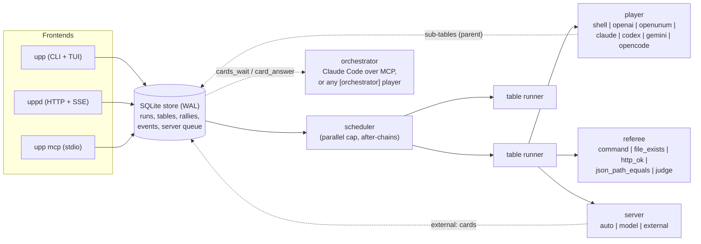

# UnumPingPong reference

Everything the [README](../README.md) leaves out: concepts, players, referees, server modes, cards, orchestrator, worktrees, recovery, the match-file format, CLI, HTTP API, MCP, library, comparison and limitations.

## Concepts

| Term | Meaning |
| --- | --- |
| **Table** | A loop with a goal: one player, one referee, one server, and a lease. |
| **Ball** | The unit of work: a brief (with templates for files and the upstream answer) plus the evidence expected. |
| **Rally** | Player answers -> referee checks -> server reviews -> the ball goes back with the referee output and a note, or the point is scored. |
| **Point** | The ball accepted with evidence. The answer is stored as the table's result and becomes `{{prev.answer}}` downstream. |
| **Card** | The compact result of one rally: the player's `<card>` block (or an extractor's reading of its answer) plus tokens, elapsed time, the referee verdict with an output tail, provenance and sub-table results. What the server reads. |
| **Orchestrator** | A long-lived server that answers the cards of many tables as they arrive: Claude Code over MCP (`cards_wait` / `card_answer`), or any adapter as an `[orchestrator]` player. |
| **Sub-table** | A table a player opens with its own table as `parent`; the parent's rally waits for it. Depth cap `max_depth` (3). |
| **Lease** | Runaway guard: wall time (2 h), max rallies (10), optional token and cost caps. The first one reached ends the table. Never used to schedule. |
| **Parallel** | Tables run at once up to `max_parallel` (per scheduler process). |
| **Serial** | `after = "other-table"`: start only after that table scored. If it ends without a point, the chain is skipped. |
| **Server** | `auto` (template feedback), `model` (another player writes the note), `external` (an outside agent answers each ball over MCP/HTTP/CLI). |

Statuses: `queued`, `running`, `awaiting_server`, then one of `point`, `lost` (max rallies),
`expired` (wall/token/cost lease), `stopped`, `skipped` (upstream failed), `error`. A running
table's phase is `setup`, `player`, `children` (waiting on its sub-tables), `referee` or
`server`.

## Architecture



The store is also the bus between processes, and waiting is event-driven: in one process a
write wakes every waiter at once (a condition variable); a write from another process is noticed
through SQLite's `data_version` within 0.4 s, with no query loop. `upp run`, `uppd` and `upp mcp` each run a
scheduler that claims queued tables atomically; `upp watch` reads the same database, so it shows
tables no matter who runs them. Stop requests and external server answers are rows too, which is
why `upp answer`, `POST /api/tables/{id}/answer` and the MCP tool `ball_answer` all work against a
table running in another process.

## Install

From source (Rust 1.85 or newer):

```bash
cargo install --git https://github.com/corpunum/unumpingpong upp uppd
# or
git clone https://github.com/corpunum/unumpingpong && cd unumpingpong
cargo build --release            # target/release/upp, target/release/uppd
```

Prebuilt binaries will be published on the
[releases page](https://github.com/corpunum/unumpingpong/releases) with the first tagged release;
then `install.sh` / `install.ps1` download and verify them (SHA256SUMS):

```bash
curl -fsSL https://github.com/corpunum/unumpingpong/releases/latest/download/install.sh | sh
```

## Quick start

No model needed for the demo: scripted fake agents, real referee commands.

```bash
upp --db /tmp/upp-demo.db run examples/demo/demo.toml --watch
```

With a local OpenAI-compatible endpoint (llama.cpp, Halogen, vLLM, Ollama `/v1`, LM Studio),
three tables write three functions in parallel, each verified by `cargo test`:

```bash
# edit base_url / model in the file first
upp run examples/three-functions.toml --watch
upp list                       # what happened
upp status fizzbuzz            # rallies, referee output, notes (JSON)
upp export > rallies.jsonl     # the trace
```

A minimal table:

```toml
[[table]]
name = "fix-tests"
goal = "cargo test passes without changing the tests"
cwd = "."
ball = "The tests fail. Fix the code, not the tests."
lease = { wall_secs = 900, max_rallies = 5, max_cost_usd = 2.0 }
player = { kind = "claude", args = ["--permission-mode", "acceptEdits"] }
referee = [{ kind = "command", run = "cargo test", timeout_secs = 600 }]
```

Examples: [fix a failing test](../examples/fix-failing-test.toml),
[three parallel functions](../examples/three-functions.toml),
[serial plan -> implement -> test](../examples/plan-implement-test.toml),
[model-free demo](../examples/demo/demo.toml), [external server demo](../examples/demo/external.toml).

## Players

| `kind` | Tool | How a rally runs | Session across rallies | Status |
| --- | --- | --- | --- | --- |
| `shell` | any command | ball on stdin, answer on stdout; `UPP_RALLY`, `UPP_TABLE`, `UPP_SESSION`, `UPP_CWD` in env | none (brief repeated in returns) | **tested** (CI) |
| `openai` | any OpenAI-compatible `/chat/completions` | conversation kept in memory; optional `X-Halogen-Keep`/`X-Halogen-From` | yes | **tested live** (Halogen, Qwen 3.8) |
| `openunum` | OpenUnum HTTP API | `POST /api/chat {sessionId, message}`, polls `/api/chat/pending` | yes (one OpenUnum session per table) | run live 2026-10-20 (2/2 points, parallel); no token counts yet |
| `claude` | Claude Code | one `claude -p --input-format stream-json --output-format stream-json` process per table, a user message per rally (`persistent = false`: `claude -p --output-format json` per rally) | same process; `--resume <session_id>` after a restart or an effort change | **run live** (2.1.303, Haiku: cloud benchmark) |
| `codex` | OpenAI Codex CLI | one `codex app-server` per table, a `turn/start` per rally on one thread (`persistent = false` or exec-only args: `codex exec --json ... -` per rally) | same thread; `thread/resume` / `exec resume <thread_id>` after a restart | **run live** (0.160.0, gpt-5.6-luna: cloud benchmark) |
| `gemini` | Gemini CLI | `gemini -o json --session-id UUID -p BALL` | `--resume <UUID>` (per project dir) | flags verified (0.45.1); output and resume checked against its source; not run live |
| `opencode` | opencode | `opencode run --format json MESSAGE` | `-s <sessionID>` | flags verified (1.18.33); event schema checked against its source; not run live |

### Using UnumSearch from players

[UnumSearch](https://github.com/corpunum/unumsearch) is a fast indexed code search (CLI, daemon
and MCP server). It is off by default; the lean default stays lean.

- **Agent CLI players** (`claude`, `codex`): `search = "unumsearch"` (or a path to the binary)
  attaches the UnumSearch MCP server and only that one. Claude Code gets
  `--mcp-config '{"mcpServers":{"unumsearch":{"type":"stdio","command":"unumsearch","args":["mcp"]}}}'
  --strict-mcp-config --allowedTools mcp__unumsearch__search,mcp__unumsearch__find_files,mcp__unumsearch__index_status`
  (all three tools are read-only); Codex gets `-c mcp_servers.unumsearch.command="unumsearch"
  -c mcp_servers.unumsearch.args=["mcp"] -c mcp_servers.unumsearch.enabled=true` while lean mode
  keeps every other MCP server off. Works with `tools = []`: search is then the player's only tool.
- **Chat players without a tool loop** (`openai`, a local model): the engine searches for them
  before rally 1, in the table's cwd (its worktree, if any), and puts the top hits into the ball.
  `{{search:query}}` in a ball is replaced by a block of hits for that literal query;
  `context_search = ["query", ...]` on a table adds a "Code search results" section. Each query
  keeps 8 hits as `path:line: text` (paths relative to the cwd, lines cut at 200 characters,
  2 KB per query). The binary is `unumsearch` on PATH or `$UPP_UNUMSEARCH`; a failed search is a
  one-line note in the ball, never a failed table.
- **Worktrees are searchable at once.** Every table worktree lives under
  `<store dir>/worktrees/`. Make that directory an UnumSearch *split root*
  (`split_roots = ["/path/to/store/worktrees"]` in its config): each worktree becomes its own
  unit, a new one is noticed by the watcher and indexed incrementally within about a second,
  and a removed one is dropped. Players using `search = "unumsearch"` then search their own
  worktree through the index.

```toml
[[table]]
name = "fix-parse"
cwd = "repo"
ball = "Fix the off-by-one in the line parser. Callers: {{search:parse_line(}}"
context_search = ["struct LineParser", "fn parse_line"]
player = { kind = "openai", base_url = "http://127.0.0.1:8080/v1", model = "local" }

[[table]]
name = "fix-parse-agent"
cwd = "repo"
ball = "Fix the off-by-one in the line parser."
player = { kind = "claude", model = "haiku", tools = ["Read", "Edit", "Bash"], search = "unumsearch" }
```

Every agent CLI must exit 0 and report no error event (`is_error`, codex `turn.failed`/`error`,
gemini `error`, opencode `error`); otherwise the rally is a fault and the ball is served again.
`claude` and `codex` players are lean by default (no MCP servers, user settings, skills,
memory or extra feature tools) and take `tools` and `system_prompt`; see
[docs/integrations/claude-code.md](integrations/claude-code.md) and
[docs/integrations/codex.md](integrations/codex.md).
"Not run live" means no model turn was paid for while building v0.1: the argv is unit-tested and
the output parsers are tested on the documented shapes. Details and caveats per tool in
[docs/integrations](integrations/README.md). Agent CLIs edit files with **your** permissions
in the table's `cwd`; pass their own permission/sandbox flags in `args`.

Chat-only models can still work on code: `apply = { write_file = "src/lib.rs" }` writes the
answer's first fenced code block to that file before the referee runs, and
`{{file:src/lib.rs}}` puts a file's current content into the ball.

## Referee

| `kind` | Passes when | Options |
| --- | --- | --- |
| `command` | exit 0 (and `expect_regex` matches stdout+stderr) | `run` (string for `sh -c`, or argv array), `timeout_secs` (300), `cwd`, `env`; `UPP_ANSWER_FILE` holds the player's answer |
| `file_exists` | the file exists (and matches `contains`) | `path` relative to the table cwd |
| `http_ok` | GET answers 2xx (or exactly `status`), body matches `expect_regex` | `url`, `timeout_secs` |
| `json_path_equals` | value at `path` (`a.b.0.c`) equals `equals` | source: `file`, `url`, or the answer itself (first JSON block) |
| `judge` | an LLM player replies with the word `PASS` first | `player` (must differ from the table's player), `rubric`; runs last, only if every deterministic check passed |

A table needs at least one check: an empty referee never passes, and `upp validate` rejects such
a table. For a step that really has nothing to verify, set `unverified = true` on the table (or
in `[defaults]`); its point is then recorded as `UNVERIFIED point on rally N` with an
`unverified` check row, so it is never mistaken for a verified one.

On failure, the return message lists the failed checks with the tail of their output (6 KB per
check), the server note, and "fix it and answer again". The first ball tells the player which
checks will run, so it knows the evidence expected.

## Server modes

- `auto` (default): referee pass = point; fail = return with the referee output.
- `model`: `server.player` writes the correction note (and, with `review_points = true`, must
  answer with the word `ACCEPT` first before a passing ball scores). Fail closed: if that review
  call fails, it is retried (3 attempts), then the table ends as `error`, never as a point. A
  failing server call on a ball the referee failed only drops the note.
- `external`: every ball waits in the server queue for `accept`, `return` (with a note) or
  `stop`, sent by `ball_answer` (MCP), `POST /api/tables/{id}/answer`, `upp answer`, or the `a`/`r`
  keys in `upp watch`. `accept` scores only if the referee passed: the referee decides, the
  server can only be stricter. `review_points` defaults to true here, `timeout_secs` to 3600.

What the server reads is the **card** and the referee output (failed checks with an 800-byte
tail), not the answer; `server.transcript = true` adds the full ball and answer, and
`transcript(table, rally)` fetches them on demand.

This is how an outside Claude Code / Codex / Gemini / OpenUnum session orchestrates: it opens
tables for cheaper or local workers and answers their cards with `cards_wait` / `card_answer`
([recipe](integrations/claude-code.md#as-the-orchestrator-over-mcp-cards_wait--card_answer)).

## Result cards

The first ball asks the player to end with a card block:

```text
<card>
done: yes
summary: parse() handles quoted fields; all 14 tests pass
evidence: python3 -m unittest -q -> OK (14 tests)
open_issues: none
artifacts: solution.py; commit 3f2a9c1
</card>
```

Without a readable block, a deterministic extractor builds the card from the answer (first
prose line, test/exit lines as evidence, TODO/"could not" lines as open issues, file paths,
commits and PR links as artifacts; `source: "extracted"`). The engine then adds what it knows
for certain: tokens, elapsed time, the referee verdict, files the table changed (from git), the
tree hash, and sub-table results. `done` is the player's claim; `referee.passed` is the truth.
Cards are stored next to the full transcript (append-only); `final` cards close each table.
`card = false` on a table stops asking for the block (the extractor still runs).

## Persistent orchestrator

Any adapter can be the server of a whole run: give the match an `[orchestrator]` and its tables
default to `server.mode = "external"`.

```toml
[orchestrator]
player = { kind = "openai", base_url = "http://127.0.0.1:8080/v1", model = "local", reasoning_effort = "low" }
instructions = "Accept when the referee passed; otherwise one precise correction from its output."
batch = 8              # cards per message when several wait
refresh_every = 40     # fresh orchestrator session after N cards (its context stays small)
max_new_tables = 50    # runaway guard on `next` / `open`
review = "referee"     # default; "required" = no point without a valid decision (3 tries, then the table stops as needs_review)
```

It sleeps until any table has a card waiting, sends every waiting card in one message, and
applies the decisions (`{"decisions": [{"table", "verdict", "note", "next", "open"}]}`). A card
it skips or garbles, or a failed orchestrator call, gets the referee's default (pass: accept;
fail: return with the referee output), so no table stalls on it. `upp orchestrate file.toml`
runs one for every waiting card in the store, across runs. Its reported tokens are charged to
the tables it served: `orchestrator_tokens` next to `player_tokens`.

## Nested tables, worktrees, provenance

- **Sub-tables.** A player's process gets `UPP_TABLE`, `UPP_RALLY`, `UPP_RUN`, `UPP_DEPTH` and
  `UPP_DB`. `upp create sub.toml --parent "$UPP_TABLE"` (MCP `table_create` with `parent`, HTTP
  `POST /api/tables?parent=ID`) opens sub-tables in the same run. They inherit the player and
  the working directory and need their own referee. When the parent runs in a worktree, each
  writer child gets its own worktree branched from the parent's branch; `read_only = true`
  children share the parent's directory. The parent's rally waits for them (without
  holding a parallel slot) before its referee runs, and their final cards appear under
  `children` in the parent's card. Depth is capped by `max_depth` (default 3).
- **Merge-up.** When the parent has its own worktree, every writer child that scores is merged
  into it before the parent's referee runs (`merge_children`, default `true`): the child's
  verified tree is committed on its branch, anything the parent has not committed yet is
  committed first, then the child branch is merged with `--no-ff`. The parent's referee
  therefore checks the combined work. A conflict aborts that merge (the parent's files stay
  as they were) and fails the rally with a `merge sub-tables` check naming the files and the
  branch, so the ball goes back to the parent to resolve it (`git merge <branch>`). Sub-tables
  of sub-tables merge into their own parent the same way, level by level.
- **Worktrees.** `worktree = { repo = "." }` (per table or in `[defaults]`) gives a table its
  own `git worktree` on branch `upp/<table>-<id>` under `<store dir>/worktrees/`. Players and the
  referee work there, isolated from each other and from your checkout. A point commits exactly
  the verified tree on that branch. `upp integrate [--run ID] [--check CMD]` merges the run's
  verified branches, in order, into a new `upp/integrate-<run>` branch (stopping at the first
  conflict) and runs the check there. Your branch is never touched.
- **Provenance.** Before the referee runs, the table's working state is written as a git tree
  through a temporary index (your index is never touched): every rally records `{commit, tree,
  dirty, changed, scope}`, so a referee result names the exact content it checked. In a table's
  own worktree the snapshot covers every non-ignored file (`scope: "all"`); elsewhere only
  tracked files (`scope: "tracked"`, via `git stash create`), because a cwd may sit inside a
  large unrelated repository. Outside git, provenance is `{git: false}`.

## Cancellation and crash recovery

`upp stop`, `table_stop` and `POST /api/tables/{id}/stop` kill the running player call's process
group at once (an HTTP player's request is abandoned; an OpenUnum turn is cancelled) and stop the
table's sub-tables. If a scheduler process dies (kill -9, crash, reboot), its tables are requeued,
not lost: `upp resume` (or a running `uppd`) continues each one after its last recorded rally,
restoring the player's session where it can (agent CLIs resume by session id; an OpenAI-style
conversation is rebuilt from the recorded rallies; otherwise the brief is repeated).

## Effort hints and `--parallel auto`

`effort = ["low", "medium", "high"]` gives rally *n* the *n*-th level (the last repeats): a cheap
first try, more thinking only after the referee returned the ball. The `openai` player sends it
as `reasoning_effort` (the player's own `reasoning_effort` is the default); `codex` gets
`-c model_reasoning_effort=...`; `shell` players see `UPP_EFFORT`; other CLIs ignore it.

`--parallel auto` (or `max_parallel = "auto"`) asks the OpenAI-compatible endpoints the tables use
how many requests they admit (`/props` `total_slots`, `/health` `slots`, or `/slots`), leaves the
requests they are already serving to that traffic (`/health` `in_flight`, `/slots`
`is_processing`; at least one slot stays yours), and caps at the sum (4 when nothing answers).
A slot count is admission, not throughput: see the benchmark.

Several runs on one machine (two `upp run`s and a `uppd`, say) each cap only their own tables.
`UPP_GLOBAL_PARALLEL=N` (or `uppd --global-parallel N`) caps the tables running at once across
every process that shares the store: one GPU or model endpoint, many runs. Each claim checks
the cap in the same SQL update, so two processes cannot both take the last slot. Tables
waiting on their own sub-tables do not count.

## Match file reference

```toml
name = "optional run name"

[defaults]                 # applied to every table that does not set the field
max_parallel = 4           # tables at once for `upp run` (default 4)
cwd = "."                  # relative paths resolve against this file's directory
player = { kind = "openai", model = "local-model" }
server = { mode = "auto" }
lease = { wall_secs = 1800, max_rallies = 5 }
referee = [ ... ]
apply = { write_file = "src/lib.rs" }
effort = ["low", "medium", "high"]   # reasoning effort per rally (openai, codex, shell)
worktree = { repo = "." }            # every table in its own git worktree

[orchestrator]             # optional: a persistent orchestrator for this match (see above)
player = { kind = "openai", model = "local-model" }

[[table]]
name = "unique-name"
goal = "what done means (shown to judges and the model server)"
ball = "the brief; templates: {{goal}} {{prev.answer}} {{prev.name}} {{table}} {{file:path}}"
after = "other-table"      # serial chain
cwd = "work/x"             # created if missing
setup = "cp -R ../fixture/. ."   # run once in cwd before rally 1; failure = error
apply = { write_file = "src/lib.rs", from = "code_block" }   # or from = "answer"
lease = { wall_secs = 600, max_rallies = 4, max_tokens = 200000, max_cost_usd = 1.5 }   # guards only
card = true                # ask for a <card> block (default true)
max_depth = 3              # deepest sub-table depth (default 3)
worktree = { repo = "..", base = "main", branch = "upp/fix", path = "/tmp/wt/fix" }
merge_children = true      # merge scored writer sub-tables into this worktree first (default true)
unverified = false         # true only for a table with no referee checks (its point is marked UNVERIFIED)
player = { kind = "claude", model = "sonnet", args = [], timeout_secs = 900, resume = true, env = {}, persistent = true, lean = true }
# claude/codex also: tools = ["Read", "Edit"] ([] = none), system_prompt = "replaces the CLI's own"
# openai: { kind = "openai", base_url, model, api_key_env, system, temperature, max_tokens, reasoning_effort, halogen_keep, extra }
server = { mode = "external", review_points = true, timeout_secs = 3600, note = "standing instruction", transcript = false }
referee = [
  { kind = "command", name = "tests", run = "cargo test", timeout_secs = 600, expect_regex = "test result: ok" },
  { kind = "judge", player = { kind = "openai", model = "other-model" }, rubric = "..." },
]
```

JSON works too (same fields; a single table object is accepted as a one-table match). Unknown
fields are rejected, so a typo fails `upp validate` instead of being ignored. No environment
variable is required; secrets are referenced by name only (`api_key_env`, `password_env`).

## CLI

```
upp [--db PATH] run <match> [--parallel N|auto] [--watch] [--exit-when-done] [--json]
upp create <match> [--parent ID]    queue for a running uppd / upp mcp; --parent: sub-tables
upp validate <match>
upp watch [--run ID | --all] [--exit-when-done]
upp list [--all] [--json]
upp status <table> [--full]         cards per rally, token split; --full adds balls and answers
upp transcript <table> [--rally N]  the full text, on demand
upp cards [--run ID] [--table T]... [--since N] [--wait SECS]
upp pending
upp answer <table> accept|return|stop [note...] [--next BALL]
upp orchestrate <file> [--run ID]   run the file's [orchestrator] for every waiting card
upp stop <table> | --run ID         kills the running player call
upp resume [--run ID]               run tables requeued after their scheduler died
upp integrate [--run ID] [--into REF] [--check CMD]
upp export [--run ID] [-o FILE]
upp mcp [--parallel N] [--queue-only]
```

The store defaults to `./.upp/upp.db` (or `$UPP_DB`). `upp run` exits 0 only when every table
scored. Without `--watch` it prints one line per event, which suits CI logs.

## HTTP API (`uppd`)

```
uppd [--listen 127.0.0.1:7878] [--db PATH] [--parallel N]

GET  /health
GET  /api/tables[?all=1&run=ID]
POST /api/tables[?parent=ID]           match JSON or a single table (?parent: sub-tables)
GET  /api/tables/{id}[?full=1]         rallies as cards, token split, pending ball
GET  /api/tables/{id}/cards
GET  /api/tables/{id}/transcript[?rally=N]
POST /api/tables/{id}/stop             kills the running player call
POST /api/tables/{id}/answer           {"verdict": "accept|return|stop", "note": "...", "next": "...", "open": {...}}
GET  /api/cards?tables=a,b&run=R&since=N&timeout=60   block until a card arrives
POST /api/integrate                    {"run": "...", "into": "...", "check": "..."}
GET  /api/pending
GET  /api/wait?tables=a,b&timeout=60   blocks until a ball waits for its server or the tables end
GET  /api/events[?since=ID]            text/event-stream, one JSON event per message
GET  /api/export[?run=ID]              JSON lines
```

Loopback only by default. Any other `--listen` address always requires a bearer token
(`Authorization: Bearer <token>`, or `?token=` for an EventSource); `--auth` requires it on
loopback too. The token comes from `UPPD_TOKEN`, `--token-file`, or
`$XDG_CONFIG_HOME/upp/token` (created 0600 with a random token if missing; uppd prints the
path, never the token). `/health` stays open. Anyone with the token can run commands as you
through a `shell` player, so treat it like an SSH key. A systemd user unit is in
[packaging/systemd](../packaging/systemd/uppd.service).

## MCP server

`upp mcp` speaks MCP over stdio (protocol `2025-06-18`) and, unless `--queue-only`, runs queued
tables itself. Tools: `table_create` (with `parent` for sub-tables), `cards_wait`, `card_answer`,
`transcript`, `table_status`, `table_list`, `table_wait`, `ball_answer`, `table_stop`,
`integrate`.

```bash
claude mcp add unumpingpong -- upp mcp
codex mcp add unumpingpong -- upp mcp
```

See [docs/integrations](integrations/README.md) for Gemini CLI, opencode, OpenUnum and any
other MCP client, and [skills/unumpingpong/SKILL.md](../skills/unumpingpong/SKILL.md) for the Agent
Skill that teaches an agent when and how to open tables.

## Library

```rust
use upp_core::{api, MatchFile, Scheduler, Store};

let m = MatchFile::load("match.toml".as_ref())?;
let store = Store::open("upp.db".as_ref())?;
let run = api::create(&store, m, None)?;
let mut s = Scheduler::new("upp.db".as_ref(), 4, "embed");
s.run = run["run_id"].as_str().map(String::from);
s.until_idle = true;
s.run()?;
```

## How it compares

Honest positioning, not a feature war:

- **A single agent loop** (an agent that runs the tests itself, aider's `--auto-test`, Claude Code
  hooks): good for one task. The agent sees its own test output and decides it is done.
  UnumPingPong moves the decision outside the agent, runs many such loops at once, chains them,
  and records every turn. It works *with* those agents as players.
- **Built-in subagents / cloud task runners** (Claude Code subagents, Codex cloud tasks): tied to
  one vendor and its models; verification is up to the subagent. Here the player is any tool,
  including local models, and the referee is yours.
- **Agent frameworks** (LangGraph, CrewAI, AutoGen): libraries for building agents and graphs in
  Python. UnumPingPong is not a framework: it drives existing agent CLIs and endpoints as
  processes, with a config file, and needs no code. It has far fewer features (one player per
  table, no graph beyond `after` chains).
- **CI**: CI verifies after a push. A table verifies every rally before anything is pushed, and
  feeds the failure straight back to the worker.

## Limitations (v0.2)

- **No sandbox.** Players and referee commands run with your user's permissions. Worktrees
  isolate tables from each other, not from your machine; use containers or the tools' own
  sandbox flags for that.
- One player per table (rotation and escalation between players are planned). No briefing
  profiles yet (learning per model family which briefs score).
- Cancellation kills the player's process group; a process that left the group (`setsid`, a
  daemon it started) survives. An abandoned HTTP request may still finish on the server.
- Crash recovery resumes after the last *recorded* rally: a rally in flight when the process
  died runs again. An OpenAI-style session is rebuilt from the recorded rallies, which drops
  failed (fault) turns.
- The parallel cap is per scheduler process (`upp run`, `uppd` and `upp mcp` each have one).
- Card fields from the extractor are heuristics; the referee verdict on the card is not.
- Token and cost budgets only count what a player reports (`shell` reports nothing).
- Tested on Linux. macOS and Windows build but are untested; `command` strings use `sh -c`
  (`cmd /C` on Windows).

## License

Apache-2.0. See [LICENSE](../LICENSE).
